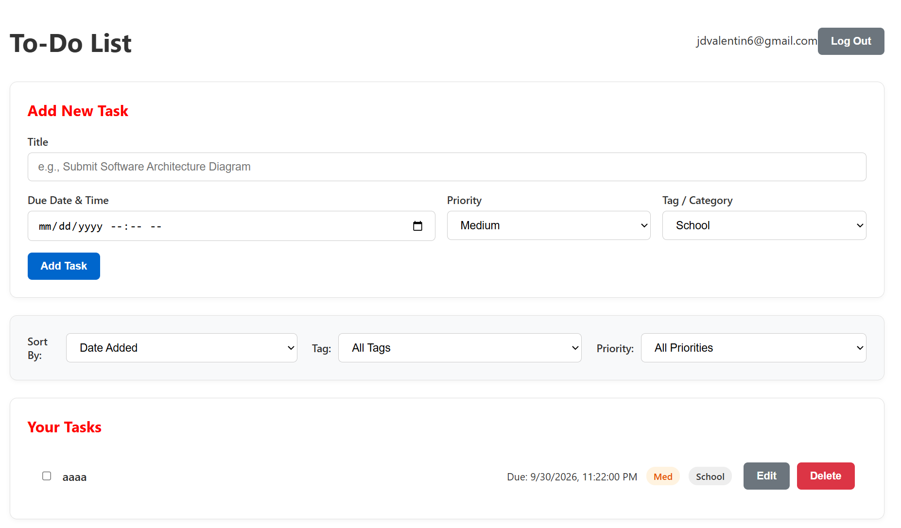
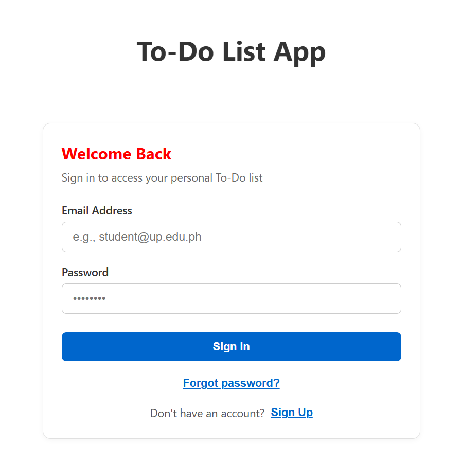
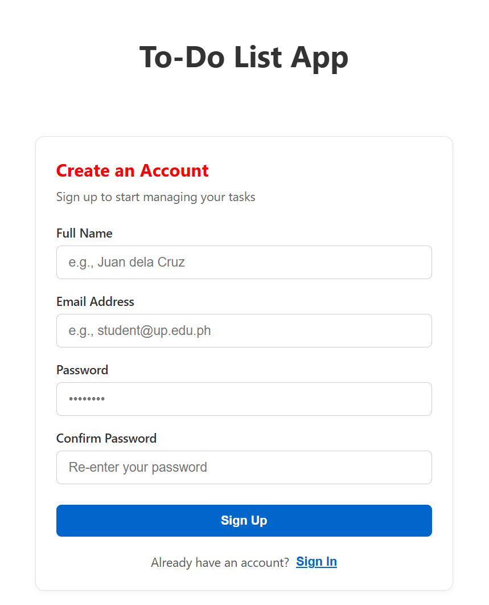
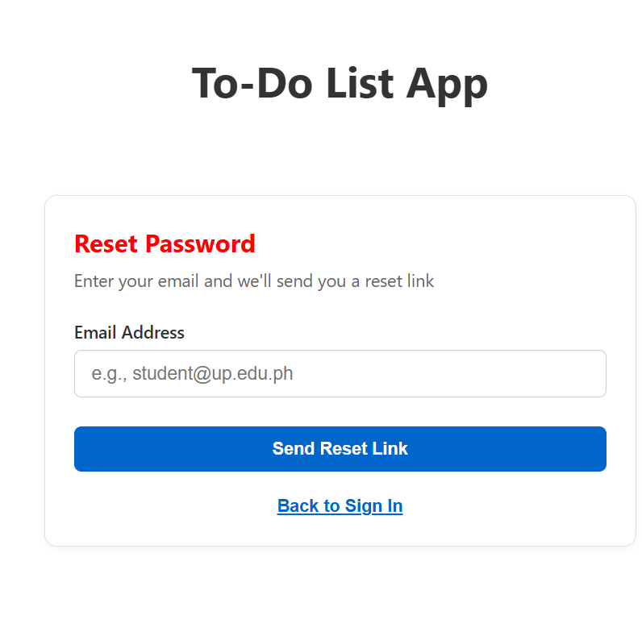

# CMSC128-Todo-List

## Authors

- Lunele Iven Moscoso
- John Dave Valentin

## Tech Stack
| Layer | Language |
| --- | --- |
| Frontend | React |
| Backend | Node.js & Express.js |
| Database | Firebase |

FERN was the chosen tech stack by us because the knowledge we will gain in building a Todo list here will serve as the foundation in building our Inventory Management System as it is the most similar tech stack to the one we will use. While quite complicated for a simple Todo list app, the knowledge to be gained in using this tech stack will be massive for us in the future.

## Requirements

- Git
- npm
- Node.js (20.x+)

## Installation & Initialization

1. Clone the repo
```bash
git clone https://github.com/Yomaruichi/cmsc128-Lab1_CRUD_ValentinMoscoso.git
cd cmsc128-Lab1_CRUD_ValentinMoscoso
```

2. Set up the client
```bash
cd client
npm install
```

3. Add Firebase configs
Create a **.env.local** file inside **client/** and insert your Firebase keys
```bash
VITE_FIREBASE_API_KEY=
VITE_FIREBASE_AUTH_DOMAIN=
VITE_FIREBASE_PROJECT_ID=
VITE_FIREBASE_STORAGE_BUCKET=
VITE_FIREBASE_MESSAGING_SENDER_ID=
VITE_FIREBASE_APP_ID=
VITE_FIREBASE_MEASUREMENT_ID=
```

4. Download a service account key (Firebase console → Project settings → Service accounts → Generate new private key), save it as `server/serviceAccountKey.json`, and create `server/.env`:

5. Run the client
If you're in the root folder
```bash
cd client
npm run dev
```
else
```bash
npm run dev
```
default address: http://localhost:5173/

6. Set up the server
```bash
cd ../server
npm install
```

7. Run the server
```bash
npm run start
```

## How Activity 1 and Activity 2 were merged

Our activity 2 already had activity 1's implementation, as most of the job was done by firebase's own account creation library.
Activity 1 got its persistent data feature by having a single uid where the api gets all the todo cards. Implementing having
multiple users was simply creating the UI for it and connecting it to firebase's account creation library. As for letting each
user only access their own todos, we changed how `api.js` and `todos.js` handles requests to now require the uid that every users
get when they make an account which is provided everytime you login. This was already implemented but just not used on activity 1 as there was no account creation yet.

## Database schema

Accounts live in Firebase Authentication (uid, email, display name, hashed password). Application data lives in Firestore and references accounts only by `uid`, so no user data is duplicated.

```
tasks/{taskId}
  ownerId    string      uid of the creator (the owner for personal tasks)
  listId     string|null null = personal task, otherwise the id of a list
  title, dueDate, priority, tag, completed, createdAt, updatedAt

lists/{listId}            (collaborative lists only)
  name       string
  ownerId    string      uid of the list owner
  memberIds  string[]    uids of everyone with access (includes the owner)
  createdAt
```

- Users → Tasks: one-to-many through `tasks.ownerId`.
- Users ↔ Lists: many-to-many through `lists.memberIds`; the list owner is `lists.ownerId`.
- Lists → Tasks: one-to-many through `tasks.listId`.

## How ownership is checked

The client never sends a user id. `requireAuth` verifies the Firebase ID token with `verifyIdToken` and sets `req.uid`; every query and check uses that value.

- Personal tasks: queries filter on `ownerId == req.uid`, and a single-task route loads the task and rejects it unless `task.ownerId === req.uid`.
- Collaborative tasks: the route loads the task's list and rejects it unless `req.uid` is in `list.memberIds`.
- Not found and not allowed look the same. Another user's task or list returns `404`, so a guessed ID reveals nothing (IDOR prevention). A member who lacks a privilege (for example a non-owner deleting a list) gets `403`.
- Mass assignment is blocked: `ownerId` and `listId` are never read from a request body on update, and `ownerId` on create always comes from the token.
- Direct database access is blocked: `firestore.rules` denies all client reads and writes, so the public web config cannot bypass the API. Only the Admin SDK in the server can reach Firestore.

The checks live in `server/lib/access.js` (`getListForMember`, `getTaskForUser`).

## Data Operations

All routes require the header `Authorization: Bearer <Firebase ID token>`. without it the response is `401`.

| Method | Route | Body | Ownership check |
| --- | --- | --- | --- |
| GET | `/api/todos?listId=personal` | none | returns only tasks where `ownerId == uid` and `listId == null` |
| GET | `/api/todos?listId=<id>` | none | caller must be in the list's `memberIds`, else 404 |
| POST | `/api/todos` | `{ title, dueDate, priority, tag, listId? }` | `ownerId` set from the token; for a list, caller must be a member |
| PUT | `/api/todos/:id` | any of `{ title, dueDate, priority, tag, completed }` | owner (personal) or list member; else 404 |
| DELETE | `/api/todos/:id` | none | owner (personal), or task creator / list owner (collaborative); else 404 or 403 |
| GET | `/api/lists` | none | only lists where `uid` is in `memberIds` |
| POST | `/api/lists` | `{ name }` | caller becomes owner and first member |
| POST | `/api/lists/:id/members` | `{ email }` | list owner only (403 for other members, 404 for non-members) |
| DELETE | `/api/lists/:id/members/:uid` | none | owner removes anyone except the owner; any member can remove themselves |
| DELETE | `/api/lists/:id` | none | list owner only; also deletes the list's tasks |

## Authentication Operations

| Action | Firebase call | Input | Result |
| --- | --- | --- | --- |
| Sign up | createUserWithEmailAndPassword | email, password, name | Creates account, sets display name, sends verification email |
| Log in | signInWithEmailAndPassword | email, password | Starts session, issues ID token |
| Log out | signOut | none | Ends session |
| Forgot password | sendPasswordResetEmail | email | Sends reset link |
| Session check | onAuthStateChanged | none | Restores logged-in user on page load |

### Session Mechanism

Implemented using Firebase Authentication combined with React Context (`authContext.jsx`)

* **Session Lifecycle & Persistence:** 

  * When a user logs in (`signInWithEmailAndPassword`) or signs up (`createUserWithEmailAndPassword`), Firebase establishes an active session and issues a secure ID token
  * The app listens to authentication state changes globally using Firebase's `onAuthStateChanged` observer inside the `AuthProvider` component
  * On page reloads or initial load, `onAuthStateChanged` automatically restores the logged-in user state, eliminating the need for manual token management in local storage
* **Protected Routes & UI Flow:** 

  * The root component (`App.jsx`) checks the `user` state from the authentication context 
  * If no user is authenticated (`!user`), the app renders the `<Login/>` component and blocks access to the to-do dashboard[cite: 1, 3]. 
  * Once authenticated, the user’s email is displayed in the header alongside a **Log Out** button which triggers Firebase's `signOut` method, clearing the session state and resetting local task data

* **API Request Authorization:** For backend operations, client requests to protected endpoints include the Firebase ID token in the header (`Authorization: Bearer <Firebase ID token>`) to ensure secure, user-scoped data access in Firestore (`users/{uid}/todos/{todoId}`)

### Password-Recovery Mechanism

* Powered by Firebase Authentication's built-in `sendPasswordResetEmail` function, managed via the `Login` component UI state (`mode === 'reset'`)

* **User Workflow:**
  1. From the sign-in screen, the user clicks the "Forgot password?" link, which switches the form view to the password recovery mode (`mode` set to `'reset'`)
  2. The user enters their registered email address and submits the form (`handleSubmit`)
  3. The app invokes the `resetPassword(email)` function mapped from `authContext.jsx`, triggering Firebase to send an official password-reset link to the user's email address
* **Security & User Privacy Handling:** 
  * To prevent user enumeration attacks (malicious actors checking if an email exists in the database), the application handles the response securely: whether or not the email is registered, the UI safely displays a neutral confirmation message: "If that email is registered, a reset link has been sent."
  * Once completed, users can click a "Back to Sign In" link to return to the login interface

## App Screenshots



