# CMSC128-Todo-List

## Authors

- Lunele Iven Moscoso
- John Dave Valentin

## Tech Stack
| Layer | Language |
| --- | --- |
| Frontend | React |
| Backend | Node.js & Express.js |
| Database | Firebase |

FERN was the chosen tech stack by us because the knowledge we will gain in building a Todo list here will serve as the foundation in building our Inventory Management System as it is the most similar tech stack to the one we will use. While quite complicated for a simple Todo list app, the knowledge to be gained in using this tech stack will be massive for us in the future.

## Requirements

- Git
- npm
- Node.js (20.x+)

## Installation & Initialization

1. Clone the repo
```bash
git clone https://github.com/Yomaruichi/cmsc128-Lab1_CRUD_ValentinMoscoso.git
cd cmsc128-Lab1_CRUD_ValentinMoscoso
```

2. Set up the client
```bash
cd client
npm install
```

3. Add Firebase configs
Create a **.env.local** file inside **client/** and insert your Firebase keys
```bash
VITE_FIREBASE_API_KEY=
VITE_FIREBASE_AUTH_DOMAIN=
VITE_FIREBASE_PROJECT_ID=
VITE_FIREBASE_STORAGE_BUCKET=
VITE_FIREBASE_MESSAGING_SENDER_ID=
VITE_FIREBASE_APP_ID=
VITE_FIREBASE_MEASUREMENT_ID=
```

4. Download a service account key (Firebase console → Project settings → Service accounts → Generate new private key), save it as `server/serviceAccountKey.json`, and create `server/.env`:

5. Run the client
If you're in the root folder
```bash
cd client
npm run dev
```
else
```bash
npm run dev
```
default address: http://localhost:5173/

6. Set up the server
```bash
cd ../server
npm install
```

7. Run the server
```bash
npm run start
```

## How Activity 1 and Activity 2 were merged

Our activity 2 already had activity 1's implementation, as most of the job was done by firebase's own account creation library.
Activity 1 got its persistent data feature by having a single uid where the api gets all the todo cards. Implementing having
multiple users was simply creating the UI for it and connecting it to firebase's account creation library. As for letting each
user only access their own todos, we changed how `api.js` and `todos.js` handles requests to now require the uid that every users
get when they make an account which is provided everytime you login. This was already implemented but just not used on activity 1 as there was no account creation yet.

## Database schema

Accounts live in Firebase Authentication (uid, email, display name, hashed password). Application data lives in Firestore and references accounts only by `uid`, so no user data is duplicated.

```
tasks/{taskId}
  ownerId    string      uid of the creator (the owner for personal tasks)
  listId     string|null null = personal task, otherwise the id of a list
  title, dueDate, priority, tag, completed, createdAt, updatedAt

lists/{listId}            (collaborative lists only)
  name       string
  ownerId    string      uid of the list owner
  memberIds  string[]    uids of everyone with access (includes the owner)
  createdAt
```

- Users → Tasks: one-to-many through `tasks.ownerId`.
- Users ↔ Lists: many-to-many through `lists.memberIds`; the list owner is `lists.ownerId`.
- Lists → Tasks: one-to-many through `tasks.listId`.

## How ownership is checked

The client never sends a user id. `requireAuth` verifies the Firebase ID token with `verifyIdToken` and sets `req.uid`; every query and check uses that value.

- Personal tasks: queries filter on `ownerId == req.uid`, and a single-task route loads the task and rejects it unless `task.ownerId === req.uid`.
- Collaborative tasks: the route loads the task's list and rejects it unless `req.uid` is in `list.memberIds`.
- Not found and not allowed look the same. Another user's task or list returns `404`, so a guessed ID reveals nothing (IDOR prevention). A member who lacks a privilege (for example a non-owner deleting a list) gets `403`.
- Mass assignment is blocked: `ownerId` and `listId` are never read from a request body on update, and `ownerId` on create always comes from the token.
- Direct database access is blocked: `firestore.rules` denies all client reads and writes, so the public web config cannot bypass the API. Only the Admin SDK in the server can reach Firestore.

The checks live in `server/lib/access.js` (`getListForMember`, `getTaskForUser`).

## Data Operations

All routes require the header `Authorization: Bearer <Firebase ID token>`. without it the response is `401`.

| Method | Route | Body | Ownership check |
| --- | --- | --- | --- |
| GET | `/api/todos?listId=personal` | none | returns only tasks where `ownerId == uid` and `listId == null` |
| GET | `/api/todos?listId=<id>` | none | caller must be in the list's `memberIds`, else 404 |
| POST | `/api/todos` | `{ title, dueDate, priority, tag, listId? }` | `ownerId` set from the token; for a list, caller must be a member |
| PUT | `/api/todos/:id` | any of `{ title, dueDate, priority, tag, completed }` | owner (personal) or list member; else 404 |
| DELETE | `/api/todos/:id` | none | owner (personal), or task creator / list owner (collaborative); else 404 or 403 |
| GET | `/api/lists` | none | only lists where `uid` is in `memberIds` |
| POST | `/api/lists` | `{ name }` | caller becomes owner and first member |
| POST | `/api/lists/:id/members` | `{ email }` | list owner only (403 for other members, 404 for non-members) |
| DELETE | `/api/lists/:id/members/:uid` | none | owner removes anyone except the owner; any member can remove themselves |
| DELETE | `/api/lists/:id` | none | list owner only; also deletes the list's tasks |

## Authentication Operations

| Action | Firebase call | Input | Result |
| --- | --- | --- | --- |
| Sign up | createUserWithEmailAndPassword | email, password, name | Creates account, sets display name, sends verification email |
| Log in | signInWithEmailAndPassword | email, password | Starts session, issues ID token |
| Log out | signOut | none | Ends session |
| Forgot password | sendPasswordResetEmail | email | Sends reset link |
| Session check | onAuthStateChanged | none | Restores logged-in user on page load |

### Session Mechanism

Implemented using Firebase Authentication combined with React Context (`authContext.jsx`)

* **Session Lifecycle & Persistence:** 

  * When a user logs in (`signInWithEmailAndPassword`) or signs up (`createUserWithEmailAndPassword`), Firebase establishes an active session and issues a secure ID token
  * The app listens to authentication state changes globally using Firebase's `onAuthStateChanged` observer inside the `AuthProvider` component
  * On page reloads or initial load, `onAuthStateChanged` automatically restores the logged-in user state, eliminating the need for manual token management in local storage
* **Protected Routes & UI Flow:** 

  * The root component (`App.jsx`) checks the `user` state from the authentication context 
  * If no user is authenticated (`!user`), the app renders the `<Login/>` component and blocks access to the to-do dashboard[cite: 1, 3]. 
  * Once authenticated, the user’s email is displayed in the header alongside a **Log Out** button which triggers Firebase's `signOut` method, clearing the session state and resetting local task data

* **API Request Authorization:** For backend operations, client requests to protected endpoints include the Firebase ID token in the header (`Authorization: Bearer <Firebase ID token>`) to ensure secure, user-scoped data access in Firestore (`users/{uid}/todos/{todoId}`)

### Password-Recovery Mechanism

* Powered by Firebase Authentication's built-in `sendPasswordResetEmail` function, managed via the `Login` component UI state (`mode === 'reset'`)

* **User Workflow:**
  1. From the sign-in screen, the user clicks the "Forgot password?" link, which switches the form view to the password recovery mode (`mode` set to `'reset'`)
  2. The user enters their registered email address and submits the form (`handleSubmit`)
  3. The app invokes the `resetPassword(email)` function mapped from `authContext.jsx`, triggering Firebase to send an official password-reset link to the user's email address
* **Security & User Privacy Handling:** 
  * To prevent user enumeration attacks (malicious actors checking if an email exists in the database), the application handles the response securely: whether or not the email is registered, the UI displays the same neutral message: "If that email is registered, we sent a reset link to it." Only `auth/user-not-found` gets this message. Network failures, rate limits and invalid emails show an error that says what to do, so a user whose request never went out is not told to check their inbox.
  * Once completed, users can click a "Back to Sign In" link to return to the login interface

## Frontend and HCI improvements

These changes follow the CMSC 134 view that a UI is a conversation with the user: every control should say what it does, every action should get an answer, and mistakes should be easy to take back.

Who uses it: UP students managing school and personal tasks, alone or in a shared group list, often on a phone between classes. Mistakes are cheap to fix but annoying, so the app favors confirmation plus undo over blocking the user.

### Delete confirmation and undo

Clicking Delete on a task opens a dialog titled with the task's name, such as `Delete "Buy groceries"?`. The buttons say what they do ("Keep task" and "Delete task"), and Keep task has focus first, so pressing Enter by accident is safe. Escape also cancels. The group-list confirmations (delete list, leave list, remove member) are unchanged.

After you confirm, the task disappears and a notice at the bottom of the screen says `Deleted "Buy groceries".` with an Undo button. The server delete waits 8 seconds. Undo inside that window puts the same task back where it was, with its original id, creator and date, because nothing was deleted yet. This is the second expanded Lab 1 feature; filter and sort is the first.

The dialog is the native `<dialog>` element (`client/src/useConfirm.jsx`), which handles focus trapping and Escape without extra code.

| Confirm | Undo |
| --- | --- |
| 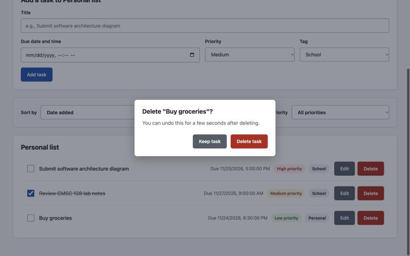 | 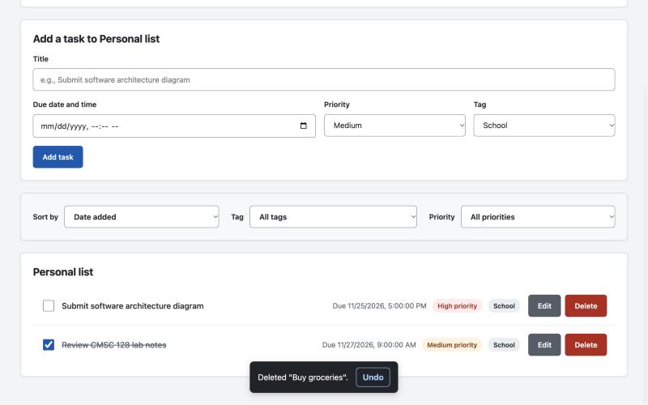 |

### Profile forms

Saving the name now updates the Firebase account (`updateProfile`), so other members of a shared list see the new name too. Changing the email asks for the current password and sends a confirmation link to the new address (`verifyBeforeUpdateEmail`); the email changes once that link is opened, and the page says so. A separate Change password form checks the current password before setting the new one. These calls live in `authContext.jsx` as `updateAccount` and `changePassword`.

### Unsaved changes

When a profile form has edits that are not saved, the page shows "You have unsaved changes." Clicking Tasks or Log out then asks `Discard your profile changes?` with "Keep editing" and "Discard changes". Closing or reloading the tab triggers the browser's own leave warning. Save changes and Discard changes stay disabled until there is something to save or discard, so their state tells you whether anything changed.

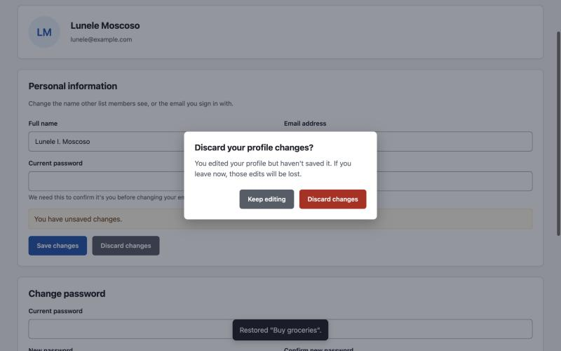

### Action feedback

Every action that waits on the server shows that it is working and then how it went:

- Task form: the button reads "Adding…" or "Saving…" while the request runs, then a notice confirms "Task added to Personal list." or "Changes saved."
- Task checkboxes and row buttons are disabled while that task's update is in flight, so a double click can't send two requests.
- Profile and password forms disable their fields while saving and report success or a specific error under the form.
- Log out reads "Logging out…" and shows an error if it fails.
- List controls (create list, add member) disable themselves and read "Working…" during a request.
- Error messages start with what failed, such as "Couldn't load tasks.", followed by the server's reason.

Errors use `role="alert"` so screen readers announce them; success notices use `role="status"`, which is announced without interrupting.

### Password recovery feedback

The reset form still shows the same neutral message whether or not an email has an account. It no longer hides real failures: a network error now says "Can't reach the server. Check your internet connection and try again." instead of claiming a link was sent.

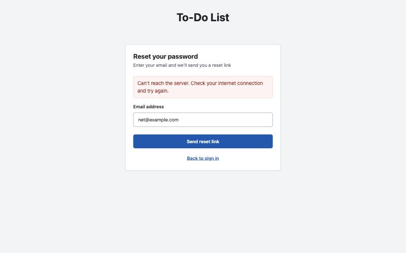

### Responsive layouts

Under 640px wide, the header stacks the greeting above the navigation, and the filter bar, task form and list controls become single columns with full-width inputs. Task rows put the title on its own line, with due date and badges below and Edit and Delete as equal-width buttons. Nothing on the page scrolls sideways at 375px. Buttons and inputs are at least 44px tall, which fits a thumb.

| Phone: top of page | Phone: task rows |
| --- | --- |
| 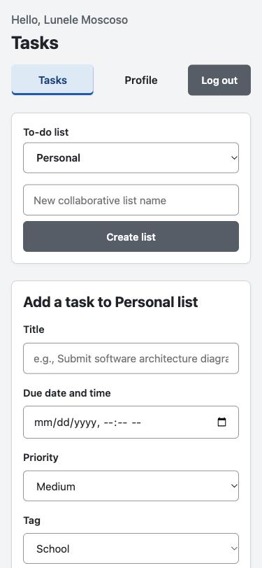 | 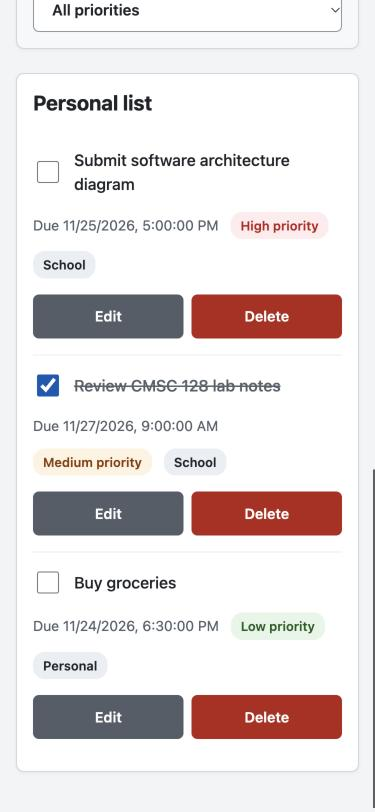 |

### Accessibility and consistency

- Each task title is the `<label>` for its checkbox, so screen readers read "Buy groceries, checkbox, not checked", and clicking the title toggles it.
- Edit and Delete buttons carry the task name in their accessible label (`Edit "Buy groceries"`).
- Every focusable element shows a 3px blue outline when reached by keyboard.
- Colors moved into CSS variables at the top of `App.css`. Text and button colors are at least 5:1 against their background; the old medium-priority orange (about 3.6:1) and the red `h2` headings are gone.
- Priority badges say "High priority" rather than relying on color.
- One spacing scale (4, 8, 12, 16, 24, 32px), one button height, and sentence case for every label ("Add task", "Log out").
- Disabled buttons are pale gray, which looks different from the dark-gray secondary buttons.

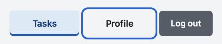

### Navigation and greeting

The header shows `Hello, <display name>`, falling back to the part of the email before the `@` when no name is set. Below it, the page title says where you are (Tasks or Your profile). The current tab is marked with a filled background, an underline and `aria-current="page"`, so the active page does not depend on color alone. Signing in always lands on Tasks.

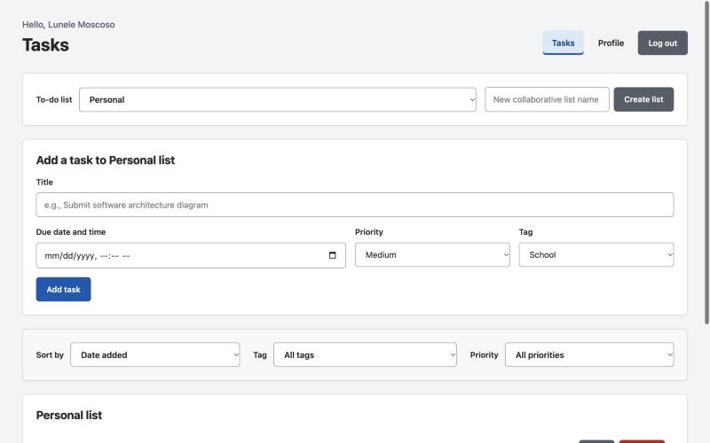

### Frontend structure

`App.jsx` keeps the state and the API calls. The parts it used to render inline are now their own components:

| File | What it shows |
| --- | --- |
| `TaskForm.jsx` | The add/edit task form |
| `TaskFilters.jsx` | The sort and filter bar |
| `TaskList.jsx` | The task list, each task row, and the loading and empty states |
| `useConfirm.jsx` | The confirm dialog, used for task deletes and unsaved changes |
| `authErrors.js` | Firebase error codes mapped to plain messages, shared by Login and Profile |

The screenshots above use sample tasks.

## App Screenshots
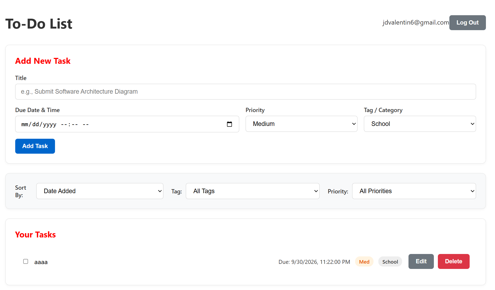
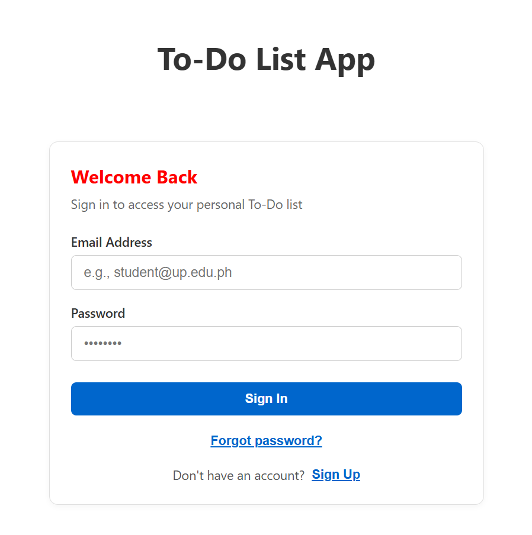
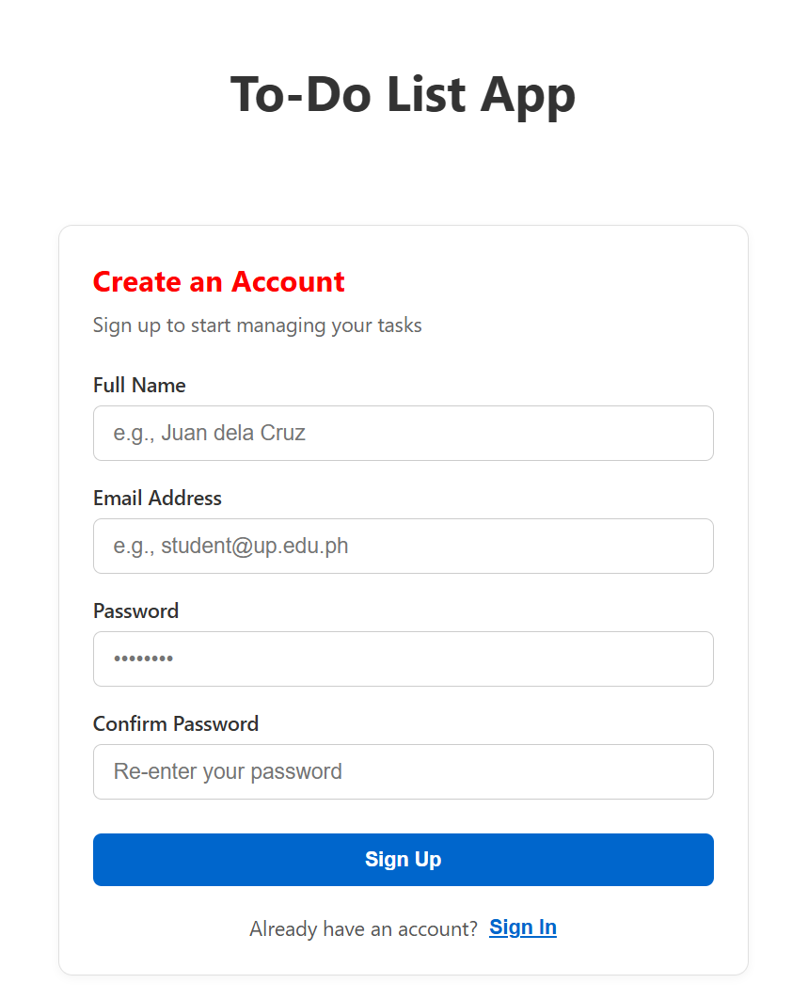
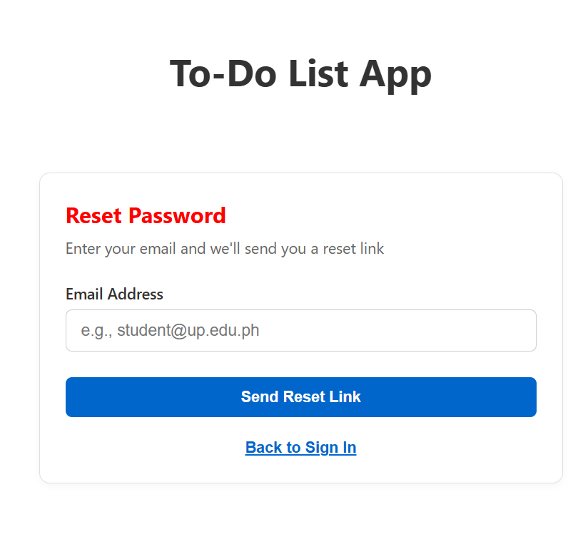